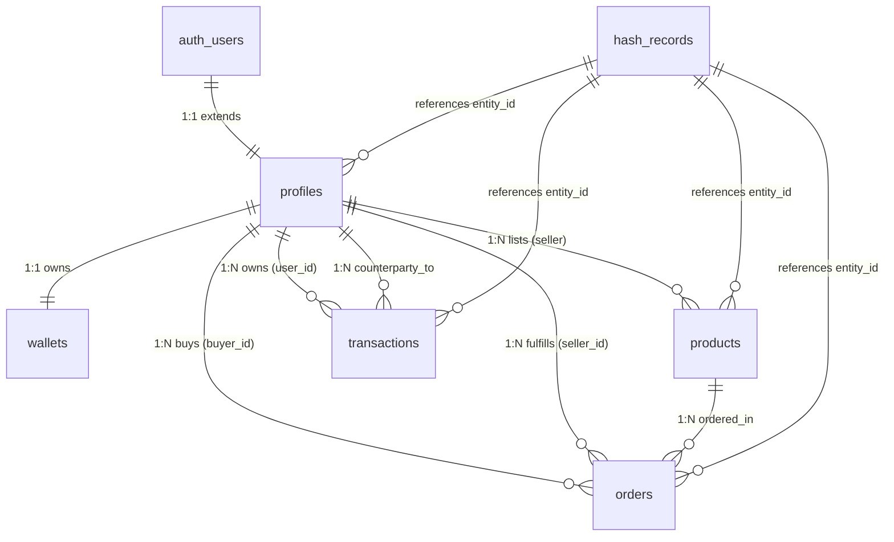

# CresoX – Backend Architecture & Recovery Documentation

**Project:** CresoX Fintech Platform  
**Target Backend:** Supabase (PostgreSQL 15+ / 16+, Supabase Auth, Supabase Storage, PostgREST)  
**Reconstruction SQL:** [`CresoX_Supabase_Backend.sql`](./CresoX_Supabase_Backend.sql)  
**Date:** November 2026  

---

## 1. Project Backend Overview

The CresoX platform is a digital asset tokenization, investment marketplace, and peer-to-peer settlement platform. Its backend infrastructure leverages the Supabase ecosystem:

- **Database Layer**: PostgreSQL database hosted on Supabase, featuring native Row Level Security (RLS), custom PostgreSQL enum types, procedural PL/pgSQL triggers, and cryptographic digest functions (`pgcrypto`).
- **Data Access & API Layer**: Supabase PostgREST, providing an auto-generated RESTful API that maps directly to public schema tables, views, and stored functions (`supabase.rpc`). Foreign key constraint names are explicitly preserved to support PostgREST joined queries (`buyer:profiles!orders_buyer_id_fkey(...)`).
- **Authentication Engine**: Supabase Auth (GoTrue), supporting email/password authentication, Google OAuth 2.0, session persistence via local storage, token auto-refresh, and URL session detection.
- **Storage Layer**: Supabase Storage with 4 dedicated public buckets (`avatars`, `company-docs`, `product-images`, `service-request-docs`) guarded by bucket-scoped storage RLS policies.
- **Audit & Cryptographic Engine**: Centralized append-only audit trail logging SHA-256 hashes for all platform events (profile creations, asset listings, orders, wallet transfers, and administrative verification status transitions).

---

## 2. Database Tables

The database consists of 7 core relational tables in the `public` schema:

| Table Name | Description | Primary Key | Key Constraints |
|---|---|---|---|
| **`profiles`** | Extends `auth.users` with platform identity, KYC documentation, role assignment, and access gate status. | `id UUID` | FK to `auth.users(id) ON DELETE CASCADE`. Checks on `role` and `approval_status`. |
| **`wallets`** | Stores user fiat/token balances (in INR). One-to-one relationship with `profiles`. Initial grant ₹1,00,000. | `id UUID` | FK `user_id` to `profiles(id) UNIQUE`. Check `balance >= 0`. |
| **`products`** | Real-world tokenized assets listed on the marketplace with pricing histories and blockchain checksums. | `id UUID` | FK `seller_id` to `profiles(id)`. Checks on `price >= 0`, `status`, and `trend`. |
| **`orders`** | Marketplace purchase orders between buyers and sellers for tokenized products. | `id UUID` | Named FKs `orders_buyer_id_fkey` and `orders_seller_id_fkey` to `profiles(id)`, `product_id` to `products(id)`. |
| **`transactions`** | Double-entry financial audit ledger tracking deposits, withdrawals, transfers, and asset purchases. | `id UUID` | Named FKs `transactions_user_id_fkey` and `transactions_counterparty_id_fkey` to `profiles(id)`. |
| **`hash_records`** | Append-only cryptographic audit trail recording SHA-256 hashes of system events. | `id BIGINT` (Identity) | Check on `entity_type`. |
| **`service_requests`** | Inbound public requests for asset tokenization and direct consultancy with file uploads. | `id UUID` | Enums `service_request_type` and `service_request_status`. Partial unique index for duplicate pending prevention. |

---

## 3. Database Relationships



### Relationship Details:
1. **`auth.users` -> `profiles`**: One-to-one. When an auth user is created, a `profiles` record is automatically inserted with `id = auth.users.id`.
2. **`profiles` -> `wallets`**: One-to-one. A user can only possess exactly one wallet row (`UNIQUE(user_id)`).
3. **`profiles` -> `products`**: One-to-many. A seller profile can create multiple product listings.
4. **`profiles` -> `orders`**: Multi-relationship. A profile can be a `buyer` or a `seller` in an order. Named constraints (`orders_buyer_id_fkey`, `orders_seller_id_fkey`) enable PostgREST to differentiate the roles.
5. **`products` -> `orders`**: One-to-many. A listed product can have multiple associated purchase orders.
6. **`profiles` -> `transactions`**: Multi-relationship. A profile owns the primary transaction (`user_id`) and may be referenced as the counterparty (`counterparty_id`).
7. **`hash_records` -> all entities**: Polymorphic relationship. Links to any platform record via `entity_type` and `entity_id`.

---

## 4. User Functionalities & Backend Operations

| User Action | Frontend Hook / Method | Backend Operation | Database Targets | Access Role |
|---|---|---|---|---|
| **Sign In with Email** | `authService.signInWithEmail` | Supabase GoTrue Auth | `auth.users` | Public / Invited |
| **Sign In with Google** | `authService.signInWithGoogle` | OAuth 2.0 flow | `auth.users` | Public / Invited |
| **Sign Out** | `authService.signOut` | Session revocation | Local token / Auth | Authenticated |
| **Reset Password** | `authService.sendPasswordResetEmail` | Dispatches reset email | `auth.users` | Public |
| **Restore Session** | `AuthContext.loadUserData` | Select profile and wallet | `profiles`, `wallets` | Authenticated |
| **Update Profile** | `profileService.updateProfile` | Update non-privileged fields | `profiles` | Own Profile |
| **Submit KYC Documents** | `profileService.requestBusinessVerification` | Upload docs + set status='Pending' | `profiles`, `company-docs` | Business Role |
| **Browse Marketplace** | `productService.getProducts` | Select active listings + join seller | `products`, `profiles` | Authenticated |
| **View Asset Details** | `productService.getProduct` | Select product by ID + seller details | `products`, `profiles` | Authenticated |
| **Create Asset Listing** | `productService.createProduct` | Insert product row + record hash | `products`, `hash_records` | Seller Role |
| **Edit Asset Listing** | `productService.updateProduct` | Update listing details / price | `products` | Asset Owner |
| **Delete Asset Listing** | `productService.deleteProduct` | Remove listing from marketplace | `products` | Asset Owner |
| **Purchase Token/Asset** | `productService.createOrder` | Atomic `execute_purchase` RPC | `orders`, `wallets`, `transactions`, `hash_records` | Authenticated Buyer |
| **View My Orders** | `productService.getMyOrders` | Select orders by buyer/seller ID | `orders`, `products`, `profiles` | Buyer / Seller |
| **Transfer Balance (P2P)** | `transactionService.transferBetweenUsers` | Atomic `execute_transfer` RPC | `wallets`, `transactions`, `hash_records` | Authenticated Sender |
| **Simulate Deposit** | `transactionService.depositSimulation` | Update wallet balance + write tx | `wallets`, `transactions` | Authenticated Owner |
| **Simulate Withdrawal** | `transactionService.withdrawSimulation` | Update wallet balance + write tx | `wallets`, `transactions` | Authenticated Owner |
| **View Transaction Feed** | `transactionService.getTransactionsForUser` | Select user transactions | `transactions`, `profiles` | Authenticated Owner |
| **Explore Hashes** | `hashService.getHashFeed` / `searchHashes` | Select and filter hash records | `hash_records` | Authenticated |
| **Submit Service Request** | `serviceRequestService.createRequest` | Check duplicate + insert request | `service_requests` | Public (Anon) |
| **Attach Request Docs** | `serviceRequestService.uploadDocuments` | Upload file to storage + update col | `service-request-docs`, `service_requests` | Public (Anon) |
| **Approve User Account** | `public.approve_user` RPC | Set approval='Approved' + hash | `profiles`, `hash_records` | Administrator |
| **Reject User Account** | `public.reject_user` RPC | Set approval='Rejected' + hash | `profiles`, `hash_records` | Administrator |

---

## 5. Authentication Architecture

### 5.1 Registration & Invite-Only Flow
The platform is strictly **invite-only**. Public self-registration is closed (`/register` displays a notice). Accounts are created either:
1. Directly in the Supabase Dashboard by an administrator.
2. Via Google OAuth sign-in.

When an account is created:
1. A row is inserted into `auth.users`.
2. The trigger `on_auth_user_created` fires `handle_new_user()`, extracting the user's full name, email, and role from authentication metadata, and inserting a row into `public.profiles` with `approval_status = 'Pending'`.
3. The trigger `on_profile_created` fires `handle_new_wallet()`, provisioning a wallet with the initial default balance of ₹1,00,000.

### 5.2 Access Gating (`ProtectedRoute.jsx`)
Access to all dashboard routes (`/dashboard/*`) is protected by a multi-tier gate:
1. **Authentication Check**: User must possess a valid, non-expired Supabase Auth session token. Unauthenticated users are redirected to `/login`.
2. **Approval Status Check**:
   - `approval_status = 'Approved'`: Full access granted to child routes.
   - `approval_status = 'Pending'`: Renders the `<AccessPending />` component with instructions indicating the account is awaiting review.
   - `approval_status = 'Rejected'`: Renders the `<AccessPending />` component with declined status messaging.

### 5.3 Session Persistence
Configured in `src/services/supabase.js`:
- `persistSession: true`: Stores JWT tokens in browser `localStorage`.
- `autoRefreshToken: true`: Automatically refreshes JWTs before expiration.
- `detectSessionInUrl: true`: Extracts OAuth tokens after redirects from Google OAuth.

---

## 6. Security & Access Control

### 6.1 Row Level Security (RLS) Principles
- **No Insecure Policies**: All permissive `USING (true)` policies on sensitive financial tables (`wallets`, `transactions`) have been eliminated.
- **Strict Own-Only Access**:
  - `wallets`: Users can only read (`SELECT`) and write (`UPDATE`) their own wallet (`user_id = auth.uid()`).
  - `transactions`: Users can only view or create transactions associated with their own `auth.uid()`.
  - `products`: Listing edits and deletions require `seller_id = auth.uid()`.
- **Privilege Escalation Protection**:
  The `protect_profile_fields()` `BEFORE UPDATE` trigger on `public.profiles` prevents regular users from tampering with privileged columns (`approval_status`, `role`, or `verification_status`) via client-side queries.

### 6.2 Security Definer Stored Procedures
To execute operations that inherently require cross-user writes without exposing permissive RLS policies:
1. **`execute_transfer(p_sender_id, p_recipient_identifier, p_amount, p_note)`**:
   - Validates that caller identity `auth.uid() = p_sender_id`.
   - Acquires row-level locks on sender and recipient wallets in consistent order (`LEAST(p_sender_id, v_recipient_id) FOR UPDATE`) to prevent deadlocks.
   - Verifies sufficient funds and executes debit/credit.
   - Generates and records double-entry transaction records and SHA-256 hashes.
2. **`execute_purchase(p_buyer_id, p_product_id)`**:
   - Validates caller identity `auth.uid() = p_buyer_id`.
   - Prevents self-purchases.
   - Atomically settles order status, debits buyer, credits seller, records dual transactions, and writes audit records to `hash_records`.
3. **`approve_user(p_email)` & `reject_user(p_email)`**:
   - Restricted exclusively to `postgres` and `service_role`. Execution is revoked from `PUBLIC`, `authenticated`, and `anon`.

---

## 7. SQL Execution Instructions

To reconstruct the entire backend from scratch:

1. Open your **Supabase Dashboard** at [supabase.com/dashboard](https://supabase.com/dashboard).
2. Select your active project.
3. In the left navigation sidebar, click **SQL Editor**.
4. Click **New query** (or the **+** button).
5. Open [`CresoX_Supabase_Backend.sql`](./CresoX_Supabase_Backend.sql), copy its entire contents, and paste them into the SQL Editor.
6. Click **Run** (or press `Ctrl + Enter` / `Cmd + Enter`).
7. Verify that all queries execute successfully. The final query in the script will output health verification tables confirming all 7 tables and 8 functions are active.
8. Approve your administrator account:
   ```sql
   SELECT public.approve_user('your-email@example.com');
   ```

---

## 8. Environment Variables

The project requires the following environment variables. Ensure these are defined in your `.env` (and `.env.local` if using Vercel CLI):

```env
# Supabase Project URL (found in Supabase Dashboard -> Project Settings -> API)
VITE_SUPABASE_URL=https://<your-project-ref>.supabase.co

# Supabase Anonymous Public Key (Project Settings -> API -> Project API Keys -> anon / public)
VITE_SUPABASE_ANON_KEY=eyJhbGciOi...

# Fallback compatibility keys (automatically supported by vite.config.js)
NEXT_PUBLIC_SUPABASE_URL=https://<your-project-ref>.supabase.co
NEXT_PUBLIC_SUPABASE_ANON_KEY=eyJhbGciOi...
```

> [!CAUTION]
> **Never expose the `SUPABASE_SERVICE_ROLE_KEY` in frontend environment variables (`VITE_*` or `NEXT_PUBLIC_*`).**
> The service role key bypasses Row Level Security and should only be used in secure server-side environments or the Supabase SQL Editor.

---

## 9. Known Limitations & Manual Configurations

1. **Google OAuth 2.0 Provider Setup**:
   The database script creates triggers to handle OAuth profiles, but the Google OAuth client credentials (Client ID and Client Secret from Google Cloud Console) must be configured manually in:
   **Supabase Dashboard -> Authentication -> Providers -> Google**.
   Redirect URLs must also be set in **Authentication -> URL Configuration -> Redirect URLs**:
   - `http://localhost:5173/dashboard` (for local development)
   - `https://your-domain.com/dashboard` (for production)
2. **Cryptographic Hashes vs. Decentralized Blockchain**:
   The current application uses SHA-256 cryptographic hashing recorded in PostgreSQL (`hash_records`). It does not deploy or interact with an on-chain smart contract on Ethereum/Polygon. Real on-chain deployment requires deploying EVM contracts and updating `hashService.js`.
3. **Email SMTP Provider**:
   Password reset emails and authentication emails use Supabase's built-in mailer by default (limited to 30 emails/hour). For production volume, configure a custom SMTP provider (SendGrid, Resend, AWS SES) in **Supabase Dashboard -> Project Settings -> Authentication -> SMTP Settings**.
